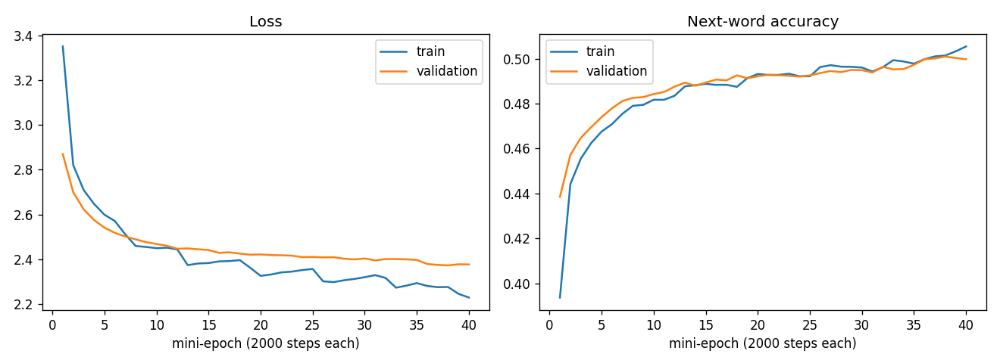

# Image Captioning: InceptionV3 + LSTM (Flickr8k, then MS-COCO)

A deep-learning model that looks at a photograph and writes a one-sentence description of it,
for example *"a soccer player kicking a soccer ball on a field"*.

It uses the classic **encoder-decoder** design:

- **Encoder (CNN):** a pre-trained **InceptionV3** turns the image into a vector of 2,048 numbers.
- **Decoder (RNN):** an **LSTM** reads the words written so far, combines them with the image
  vector, and predicts the next word. Repeating this produces a full caption.

A **Streamlit web app** lets you upload a photo and get a caption.

**Project status: finished.** Two models were trained, and the final one (MS-COCO) is the one the app uses.

---

## Results at a glance

| | Model 1: Flickr8k | Model 2: MS-COCO (final) |
|---|---|---|
| Training images | about 8,000 | 118,287 |
| Training captions | about 40,000 | 591,022 |
| Vocabulary | 2,986 words | 10,183 words |
| Parameters | 2.65 million | 6.34 million |
| BLEU-1 | 0.562 | **0.658** |
| BLEU-2 | 0.375 | **0.482** |
| BLEU-3 | 0.248 | **0.349** |
| BLEU-4 | 0.162 | **0.254** |
| Scores measured on | 500 Flickr8k validation images | 1,000 COCO val2017 images |

BLEU is measured on images the model never trained on, with beam search width 3.
The two columns use different test sets, so the comparison is indicative, not exact.
The COCO model is clearly better on everyday scenes (see the examples and limitations below).

---

## Table of contents

1. [How it works](#1-how-it-works)
2. [Final model (MS-COCO)](#2-final-model-ms-coco)
3. [Results and example captions](#3-results-and-example-captions)
4. [Known limitations](#4-known-limitations)
5. [What was done: short history](#5-what-was-done-short-history)
6. [How to run](#6-how-to-run)
7. [Repository structure](#7-repository-structure)
8. [Future work](#8-future-work)

The full story, including every bug found and every decision, is in
[`docs/PROJECT_HISTORY.md`](docs/PROJECT_HISTORY.md).

---

## 1. How it works

```
 PREPARATION (once)                                   TRAINING              USING THE MODEL
 ──────────────────                                   ────────              ───────────────

 captions ──► clean text ──► rare words -> "unk"      features + tokens     new photo
              add startseq / endseq ──► tokenizer     ──► LSTM decoder          │
                                                          learns "next word"    ▼
 images ──► resize 299x299 ──► InceptionV3 (frozen)         │            InceptionV3 -> 2048 numbers
            scale to [-1, 1]   ──► 2048 numbers              ▼                  │
                               (saved once to disk)    caption_model.h5         ▼
                                                                      beam search -> caption
```

Because the CNN is frozen, image features are computed **once** and stored. Training only trains the
small decoder, which keeps training affordable.

**One training example** is "the image plus the first k words of a caption" -> "word k+1".
A caption such as *"a dog runs"* therefore produces three examples:
(image, `startseq`) -> `a`, (image, `startseq a`) -> `dog`, (image, `startseq a dog`) -> `runs`.

---

## 2. Final model (MS-COCO)

### Encoder (frozen)

| Setting | Value |
|---|---|
| Network | InceptionV3, ImageNet weights, no classification head, global average pooling |
| Input | 299 x 299 x 3 RGB, pixels scaled to [-1, 1] |
| Output | 2,048 numbers, L2-normalised |

The encoder is defined once in [`src/encoder.py`](src/encoder.py) and shared by feature extraction,
the model and the predictor, so training and prediction can never disagree about image size or
preprocessing.

### Decoder (trained): "merge" architecture

```
 IMAGE BRANCH                                   CAPTION BRANCH
 image_input (2048)                             seq_input (32 word indices, padded after)
      │                                              │
 Rescaling x sqrt(2048)                         Embedding (vocab 10,183 -> 256, mask_zero)
      │                                              │
 Dense 256, ReLU                                Dropout 0.3
      │                                              │
 LayerNormalization                             LSTM 256
      │                                              │
 Dropout 0.3                                    LayerNormalization
      │                                              │
      └──────────────►  add()  ◄─────────────────────┘
                         │
                  Dense 256, ReLU
                         │
             Dense 10,183, Softmax  ->  probability of every possible next word
```

Why the unusual parts:

- **`Rescaling` + `LayerNormalization`:** L2-normalised features are tiny (about 0.02 each), which made the
  image branch much weaker than the LSTM branch. Scaling brings them back to about 1, and layer
  normalisation keeps both branches on the same scale when they are added.
- **Dropout after the Dense layer, not on the raw image vector:** heavy dropout on the input threw away
  useful signal.
- **`mask_zero=True`:** the LSTM ignores the padding.

### Text preparation

| Setting | Value |
|---|---|
| Cleaning | lower-case, remove punctuation and numbers, drop one-letter words |
| Rare words | words seen fewer than 5 times become `unk` (and `unk` is blocked at prediction time) |
| Long captions | captions over 30 words are dropped; at most 5 captions kept per image |
| Longest sequence | 32 tokens (including `startseq` and `endseq`) |

### Training

| Setting | Value |
|---|---|
| Optimizer / loss | Adam, learning rate 1e-3 (halved after 4 mini-epochs without gain) / sparse categorical cross-entropy |
| Batch size | 512 |
| Length | 40 "mini-epochs" of 2,000 steps = 80,000 steps (about 41 million samples) |
| Stopping rule | stop after 10 mini-epochs without a better validation loss, or at 40 mini-epochs |
| Result | validation loss about 2.38, validation next-word accuracy about 50% |
| Saved after every mini-epoch | so a Colab disconnect never loses more than a few minutes of work |



Training and validation curves stay close together, so the model is **not overfitting**.
Validation loss was still falling slowly when the 40 mini-epoch limit was reached, so longer training
would probably help a little (not tested).

### Prediction

- **Beam search**, width 5 in the app (width 3 for the BLEU numbers): keeps the 5 best partial sentences at
  every step and returns the best complete one.
- **`unk` is never allowed** in a caption.
- **Repetition guard:** a caption stops if a word repeats three times in a row.

---

## 3. Results and example captions

BLEU (higher is better), COCO val2017, 1,000 images, beam 3:

| BLEU-1 | BLEU-2 | BLEU-3 | BLEU-4 |
|---|---|---|---|
| 0.658 | 0.482 | 0.349 | 0.254 |

The raw numbers are in [`docs/results/coco_bleu_results.json`](docs/results/coco_bleu_results.json).

**Real captions from the app (photos from outside the training data):**

| Photo | COCO model caption | Verdict |
|---|---|---|
| A child kicking a football | "a soccer player kicking a soccer ball on a field" | Correct |
| Older men playing chess at a table | "a group of people sitting around a table with a cake" | People at a table is right, **"cake" is false** |
| A single tiger lying on a rock | "a couple of zebra standing next to each other on a lush green field" | **False**: wrong animal and wrong number |
| A close-up photo of a person's face | "a man holding a doughnut up to his face" | **False**: nothing is held |

For comparison, the Flickr8k model (model 1) said *"a brown dog is running through a field with a stick in its
mouth"* for the tiger photo and *"a man and a woman smile for the camera"* for the chess photo.

---

## 4. Known limitations

- **It states wrong objects with confidence on photos unlike its training data.** In the four examples above,
  three captions contain a false object. BLEU does not show this, because it only measures word overlap
  with human captions.
- **Rare things are mapped to the nearest familiar thing.** To my knowledge, tigers and chess are not among
  COCO's 80 labelled object categories. The model answers "zebra" for a tiger. With Flickr8k the same
  failure showed up as "dog": the word `tiger` appeared only 21 times in its 40,000 captions, mostly for
  tiger-striped dogs and toy tigers.
- **Close-up faces are a weak spot.** A likely (untested) reason is that close-up faces in the training
  captions are often people eating or holding food.
- **Fine details are unreliable:** colours, counts, ages, small objects.
- **Not a general-purpose captioner.** A much larger pre-trained captioning model (for example BLIP) would
  handle odd photos better, but it was not part of this project.
- **No confidence estimate.** The app cannot say "I am not sure".

---

## 5. What was done: short history

Full details in [`docs/PROJECT_HISTORY.md`](docs/PROJECT_HISTORY.md).

| Stage | What was built | Outcome |
|---|---|---|
| 1. First model (Flickr8k, VGG16) | VGG16 features + LSTM | About 38% next-word accuracy and the **same caption for every image**: the model had learned only the language pattern and ignored the image |
| 2. Fixes | Shuffled mixed-image batches, richer VGG16 features, dropout moved, rare-word filter, beam search | Captions now differed per image. BLEU-1 0.536, BLEU-4 0.166 (100 images) |
| 3. Better encoder | InceptionV3, rescaled and normalised image branch, `unk` blocked | BLEU-1 0.562, BLEU-4 0.162 (500 images). Failures on odd photos remained |
| 4. Failure analysis | Counted words in the training captions and read the actual "tiger" and "chess" captions | Found the cause: too few real examples (at most 2 real tiger photos among the 10 images that mention a tiger, and a single chess photo) |
| 5. MS-COCO | A resumable pipeline: 118,287 images, 591,022 captions, saved to Google Drive after every step | BLEU-1 0.658, BLEU-4 0.254. Better on everyday scenes, still wrong on tigers and face close-ups |

---

## 6. How to run

### A. Use the app (needs the trained files)

The trained model files are **not stored in git** (they are large and listed in `.gitignore`). The app needs these
four files in `models/`: `caption_model.h5`, `tokenizer.pkl`, `meta.json`, `word_index.json`.
They are produced by the COCO pipeline (section C).

```bash
python -m venv venv
venv\Scripts\activate                 # Windows (Linux/Mac: source venv/bin/activate)
pip install -r requirements.txt
streamlit run app/app.py
```

The first launch downloads the InceptionV3 ImageNet weights (about 90 MB) automatically.

### B. Train the Flickr8k model (original project)

Download Flickr8k into `data/` (the folder is git-ignored), then run in order:

```bash
python src/caption_preprocessing.py   # clean captions, build tokenizer
python src/feature_extraction.py      # InceptionV3 features for every image (slow, once)
python src/train.py                   # train the LSTM decoder
python src/evaluate.py                # BLEU scores
python src/diagnose.py                # sanity checks
```

`evaluate.py` and `diagnose.py` are written for the Flickr8k files. For the COCO model use Step 4 of the
COCO pipeline instead.

### C. Train the COCO model (Google Colab, resumable)

See [`coco_pipeline/README.md`](coco_pipeline/README.md) for the step-by-step guide. In short: upload
`coco_pipeline.zip` to Google Drive, open `coco_colab.ipynb` in Colab with a T4 GPU, and run the cells one
at a time. Every step saves to Drive, so after a disconnect you reconnect and run the same cell again.

After Step 5, download `caption_model.h5`, `tokenizer.pkl`, `word_index.json` and `meta.json` from Drive
into `models/`. The app reads `max_length` from `meta.json`.

---

## 7. Repository structure

```
image-captioning/
├── app/
│   └── app.py                    Streamlit web app
├── src/                          Flickr8k pipeline and the code the app uses
│   ├── encoder.py                image encoder (InceptionV3), shared by all scripts
│   ├── caption_preprocessing.py  caption cleaning, rare-word filter, tokenizer
│   ├── feature_extraction.py     image features
│   ├── data_preprocessing.py     train/val split and mixed-batch data generator
│   ├── model.py                  merge-architecture model definition
│   ├── train.py                  training
│   ├── predict.py                beam search / greedy decoding (used by the app)
│   ├── evaluate.py               BLEU on Flickr8k validation images
│   └── diagnose.py               feature and caption sanity checks
├── coco_pipeline/                resumable MS-COCO pipeline for Colab (steps 1 to 5)
├── notebooks/                    early exploration notebooks (original VGG16 version)
├── docs/
│   ├── PROJECT_HISTORY.md        detailed history, bugs found, decisions
│   └── results/                  training curves and BLEU results
├── models/                       trained files (git-ignored, see section 6)
├── data/                         datasets (git-ignored)
├── requirements.txt
└── README.md
```

The notebooks in `notebooks/` document the first VGG16 version and are kept for reference.

---

## 8. Future work

- **Compare against a pre-trained captioner** (such as BLIP) side by side in the app, as a baseline.
- **Confidence warning:** warn when a photo looks unlike the training data (compare its feature vector with the
  training features) or when beam-search confidence is low.
- **Train longer:** validation loss was still improving slowly at the stopping point.
- **Attention:** let the decoder look at different image regions for each word.
- **Better evaluation:** measure false-object rates by hand on a set of photos, and add CIDEr or METEOR.
- **Other encoders:** ResNet50, EfficientNet or CLIP. Only `src/encoder.py` would need to change.

---

## Acknowledgements

- Datasets: Flickr8k (Hodosh, Young, Hockenmaier, 2013) and MS-COCO (Lin et al., 2014).
- InceptionV3: Szegedy et al., "Rethinking the Inception Architecture for Computer Vision".
- Architecture inspired by "Show and Tell: A Neural Image Caption Generator" (Vinyals et al.).
